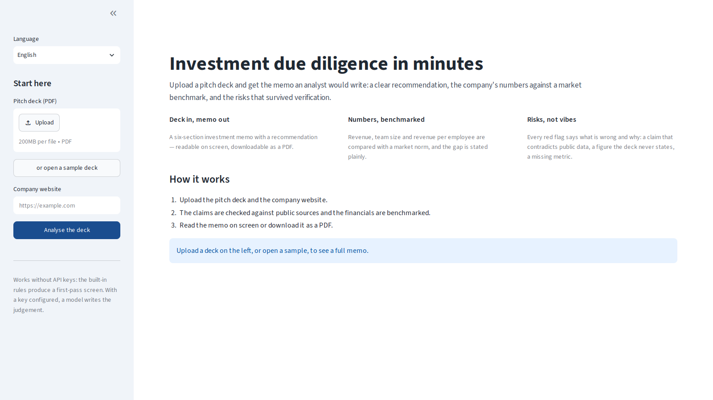
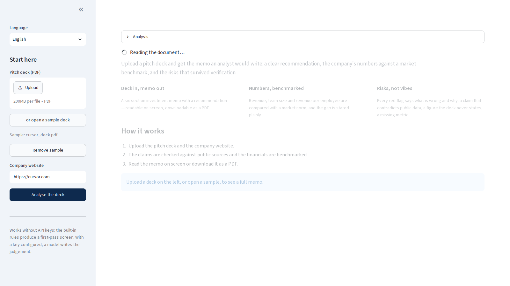
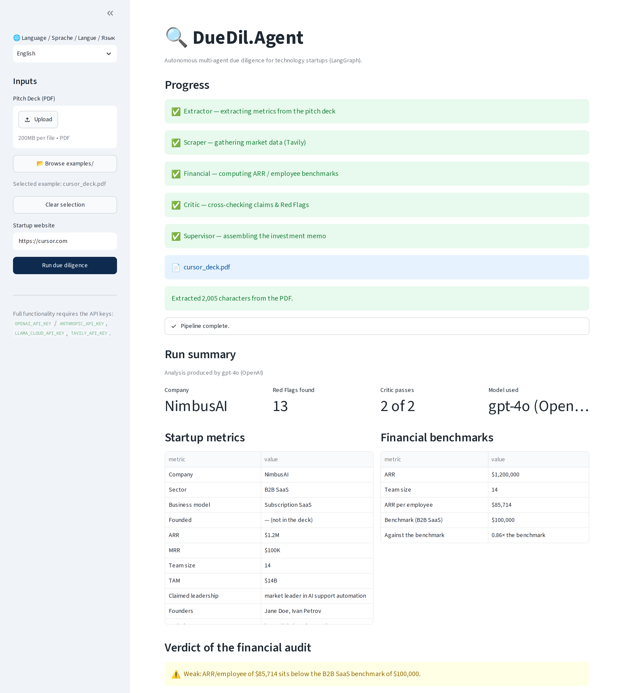
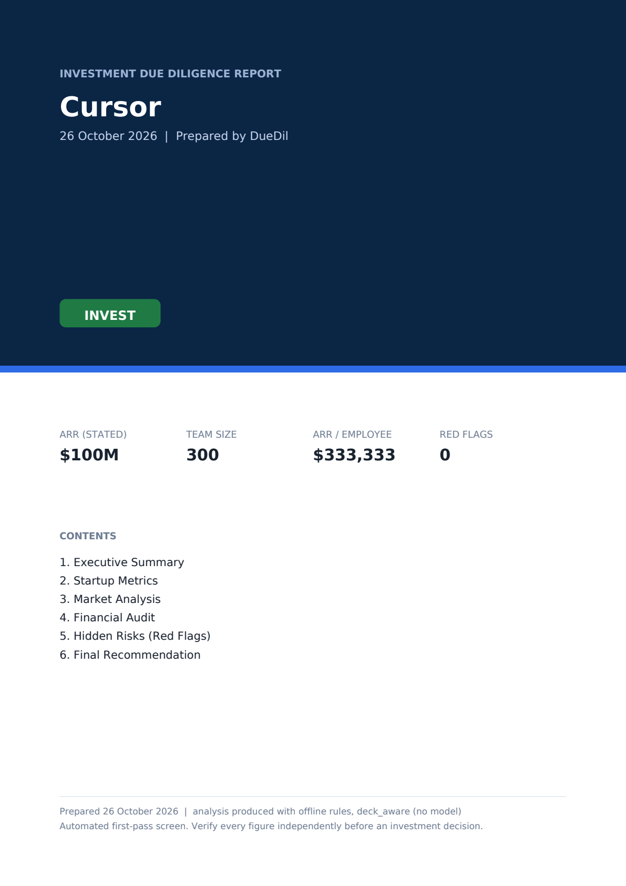
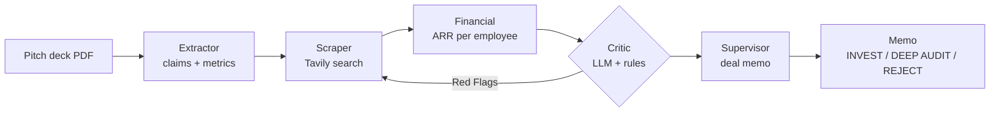

# DueDil.Agent

> **An autonomous due-diligence analyst.** Feed it a startup's pitch deck and website; five
> specialised AI agents verify every claim against live web data and produce a board-ready
> investment memo — in minutes, with the evidence trail attached.

[](https://github.com/SergeyGer/duedil-agent/actions/workflows/ci.yml)
[](https://github.com/SergeyGer/duedil-agent/security/code-scanning)
[](#engineering-standards)
[](https://github.com/SergeyGer/duedil-agent/releases)
[](LICENSE)

[](https://www.python.org/)
[](https://github.com/langchain-ai/langgraph)
[](https://platform.openai.com/)
[](https://streamlit.io/)
[](Dockerfile)
[](https://github.com/SergeyGer/duedil-agent/pkgs/container/duedil-agent)

**▶ [Try the live demo](https://duedil-agent-cnrm2wvfew6nstsu2tpsvh.streamlit.app)** — the real UI
in a browser, no installation and no API keys.

---

## Choose your path

| If you are… | You need | Start here |
|---|---|---|
| **A visitor** — deciding whether this is worth 5 minutes | nothing installed | [See it work](#see-it-work) · [the live demo](https://duedil-agent-cnrm2wvfew6nstsu2tpsvh.streamlit.app) · [Product Overview](https://github.com/SergeyGer/duedil-agent/wiki/Product-Overview) |
| **An engineer** — reading, running or changing the code | Python 3.11+ or Docker | [Run it locally](#run-it-locally) · [Architecture](https://github.com/SergeyGer/duedil-agent/wiki/Architecture) · [Testing & Quality Gates](https://github.com/SergeyGer/duedil-agent/wiki/Testing-and-Quality-Gates) |
| **An operator** — deploying, configuring or debugging it | Docker, a server or a cloud account | [Installation & Deployment](https://github.com/SergeyGer/duedil-agent/wiki/Installation-and-Deployment) · [Configuration](https://github.com/SergeyGer/duedil-agent/wiki/Configuration) · [Troubleshooting](https://github.com/SergeyGer/duedil-agent/wiki/Troubleshooting) |

Everything below is written for those three readers in that order: what it does, how to run it,
how it is built.

---

## See it work

A real run — five agents, two passes of critical re-verification, and a memo that ends in
**REJECT** because the deck does not survive scrutiny. No upload needed: the sidebar offers
**five bundled example decks** behind the sidebar's *Browse examples* button, and the run summary
states which model produced the analysis:

<video src="docs/media/demo-offline.mp4" controls width="820"></video>

[▶ watch the 22-second walkthrough](docs/media/demo-offline.mp4) ·
[the same pipeline against real APIs (47 s)](docs/media/demo-live.mp4)

| Pick a deck (or upload one) | Agents work through it | Out come the metrics, the verdict and the memo |
|---|---|---|
|  |  |  |

The results are rendered for a reader, not for a machine: metrics and the financial audit as
tables, missing figures labelled `— (not in the deck)`, and the audit's conclusion in its own
highlighted callout — ✅ above the benchmark, ⚠️ below, ❔ not computable.

---

## The problem it solves

First-pass due diligence is slow, repetitive and inconsistent: read the deck, search the
founders, check the competitors, sanity-check the revenue, write the memo — and two analysts
produce two different memos from the same deck.

The expensive part is not the writing. **It is that nothing in the deck is verified.**

DueDil.Agent automates that first pass as a deterministic pipeline instead of one opaque
prompt. Its guiding rule: *never trust the deck*. Every number is either corroborated by
external evidence or explicitly flagged — a missing figure is reported as `[NOT_FOUND]`, never
guessed.

| | Manual first pass | DueDil.Agent |
|---|---|---|
| Time to a written memo | 2–4 hours | ~2 minutes |
| Evidence behind each claim | In the analyst's head | Quoted in the artefact, with the source data attached |
| Consistency between analysts | Varies | Same pipeline, same rules, same output shape |
| Obvious contradictions | Missed when tired | Caught by deterministic rules, every time |
| Cost per review | Analyst hours | Cents of model and search calls |

---

## What it does

**Five specialised agents, one deterministic pipeline**

1. **Extractor** — reads the deck and pulls out the claimed metrics.
2. **Scraper** — searches the live web: competitors, traffic, founder footprint.
3. **Financial** — benchmarks `ARR / headcount` against the B2B-SaaS norm.
4. **Critic** — cross-checks every claim and hunts for Red Flags.
5. **Supervisor** — writes the memo and the recommendation.

**What makes the result trustworthy**

- **Hybrid Red-Flag detection** — LLM judgement *plus* deterministic rules that cannot be
  talked out of a contradiction.
- **Bounded self-correction** — the Critic can send the graph back for a targeted second
  search, hard-capped so cost and runtime stay predictable.
- **Graceful degradation** — a missing key or a failed call narrows the analysis instead of
  breaking the run.
- **Deterministic fallback** — with no model reachable at all, it still produces a memo.

**The deliverable** is a structured memo — executive summary, metrics, market analysis,
financial audit, Red Flags, and a recommendation of `INVEST` / `DEEP AUDIT` / `REJECT` —
exported as a styled PDF, with the complete evidence trail available as JSON.



---

## Try it

**1 — In a browser, nothing to install:**

▶ **[duedil-agent.streamlit.app](https://duedil-agent-cnrm2wvfew6nstsu2tpsvh.streamlit.app)**

The Streamlit Community Cloud instance runs without API keys, so it never spends anything: PDF
parsing falls back to the local `pypdf` extractor, the agents run against a deterministic
snapshot, and the whole pipeline still produces a memo. It sleeps after 12 hours without
visitors — the first visit takes ~30 seconds to wake it up.

**2 — In Docker, using the published image (no build, no clone):**

```bash
docker run --rm -p 8501:8501 ghcr.io/sergeyger/duedil-agent:latest                        # real UI
docker run --rm -p 8501:8501 -e DUEDIL_MODE=demo-ui ghcr.io/sergeyger/duedil-agent:latest  # offline demo
```

**3 — From source, with the full stack:**

```bash
git clone https://github.com/SergeyGer/duedil-agent.git
cd duedil-agent
cp env.example .env              # optional: add your own keys for live model + web search
docker compose up --build        # → http://localhost:8501
```

No API keys are required anywhere above: the interface still works and the pipeline still runs —
it degrades to the deterministic mode and says so. To watch the *full* agent behaviour with zero
cost and no network:

```bash
make demo                        # offline run: the real graph, canned model and search
```

Prefer plain Python? `pip install -r requirements.txt`, then either
`streamlit run app/ui.py` or `python -m app.cli deck.pdf https://startup.example`.
Full instructions: [Installation & Deployment](https://github.com/SergeyGer/duedil-agent/wiki/Installation-and-Deployment).

---

## Engineering standards

This is a portfolio project, so it is built the way production software is built — not as a
notebook that happens to run.

| Practice | How it shows up here |
|---|---|
| **Tested behaviour** | **79 automated tests, 90 % line coverage**, runnable offline in ~6 seconds; CI fails below 88 % |
| **Static analysis** | **CodeQL** (`security-and-quality`) on every push, PR and weekly — [zero open alerts](https://github.com/SergeyGer/duedil-agent/security/code-scanning) |
| **Continuous integration** | Every PR runs the tests on **Python 3.11, 3.12 and 3.13**, plus linting, formatting and pre-commit hygiene checks |
| **Protected delivery** | `main` requires a pull request plus passing status checks; releases are tag-driven and verify that the tag matches the package version |
| **Supply-chain discipline** | Every GitHub Action pinned to a commit SHA; Dependabot keeps them current weekly |
| **Reproducibility** | Pinned lockfile, multi-stage Docker image, non-root runtime user, container healthcheck |
| **Documentation as code** | The project ships a technical wiki, a reproducible offline demo, and a scripted screenshot/video capture |
| **Honest engineering** | Known limits, failure modes and the one accepted upstream advisory are documented rather than hidden |

---

## Under the hood, briefly

A **LangGraph** pipeline of five nodes sharing one typed state. The Critic sits in a feedback
loop that can request a targeted re-verification, capped at two passes so a run always
terminates. Red Flags come from two independent sources — an LLM critic and deterministic
heuristics — so an obvious contradiction is caught even on a bad model day. Every external
dependency (model, PDF parser, web search) is optional and degrades gracefully.



The Critic can send the graph back to the Scraper for one targeted re-verification; the loop is
hard-capped at two passes, so every run terminates.

| | |
|---|---|
| **Orchestration** | LangGraph, LangChain |
| **Models** | `gpt-4o` (OpenAI) · `claude-3-5-sonnet` (Anthropic) |
| **Document parsing** | LlamaParse, with a local `pypdf` fallback |
| **Live verification** | Tavily web search |
| **Interfaces** | Streamlit (4 languages) · CLI · Python API |
| **Export** | ReportLab (Markdown → styled PDF) |
| **Observability** | LangSmith tracing, one environment variable |
| **Packaging** | Docker + Docker Compose, pinned `pip` lockfile |

The technical reference — architecture, the Red-Flag rule set with its exact thresholds,
configuration, deployment, design rationale and troubleshooting — lives in the
**[Engineering Wiki](https://github.com/SergeyGer/duedil-agent/wiki)**.

---

## Documentation map

The README is the landing page; the **[wiki](https://github.com/SergeyGer/duedil-agent/wiki)** is
the reference. Read a page when the question matches it — every page states its owner and when it
was last reviewed.

| Page | Read it when… |
|---|---|
| [Product Overview](https://github.com/SergeyGer/duedil-agent/wiki/Product-Overview) | you want the problem, the workflow and the outcome without code |
| [Architecture](https://github.com/SergeyGer/duedil-agent/wiki/Architecture) | you need the state machine, the node contracts and the termination proof |
| [Red-Flag Engine](https://github.com/SergeyGer/duedil-agent/wiki/Red-Flag-Engine) | you want to know exactly which rule raises which flag |
| [Answer Quality & Guardrails](https://github.com/SergeyGer/duedil-agent/wiki/Answer-Quality) | you are asking how LLM answers are verified and what stops a made-up figure |
| [Recipes](https://github.com/SergeyGer/duedil-agent/wiki/Recipes) | you just need the command for a routine task |
| [Installation & Deployment](https://github.com/SergeyGer/duedil-agent/wiki/Installation-and-Deployment) | you are running it locally, in Docker, on a server or on Streamlit Cloud |
| [Configuration](https://github.com/SergeyGer/duedil-agent/wiki/Configuration) | you are changing the model, the parser or tracing |
| [Interfaces](https://github.com/SergeyGer/duedil-agent/wiki/Interfaces) | you are calling it from Python or integrating it |
| [Testing & Quality Gates](https://github.com/SergeyGer/duedil-agent/wiki/Testing-and-Quality-Gates) | you want to know what CI enforces and why |
| [Troubleshooting](https://github.com/SergeyGer/duedil-agent/wiki/Troubleshooting) | something failed and you want the cause, not a guess |
| [Design Decisions](https://github.com/SergeyGer/duedil-agent/wiki/Design-Decisions) · [ADRs](docs/adr/README.md) | you are asking "why is it built this way?" |
| [Security & Limits](https://github.com/SergeyGer/duedil-agent/wiki/Security-and-Limits) | you are assessing the risk, the data flow or the threat model |
| [Reference](https://github.com/SergeyGer/duedil-agent/wiki/Reference) · [Glossary](https://github.com/SergeyGer/duedil-agent/wiki/Glossary) | you need a variable, a flag or a term |
| [Changelog](CHANGELOG.md) · [Versioning](docs/VERSIONING.md) · [Owners](docs/OWNERS.md) | you are releasing, upgrading or looking for the right reviewer |

## Run it locally

```bash
./start.sh      # Linux/macOS/WSL — or .\start.cmd on Windows
./stop.sh       # frees the port again
```

That is the whole quick start: it builds if needed, waits until the app answers and prints the
address (<http://localhost:8501>). The port binds to `127.0.0.1`, nothing starts by itself after a
reboot, and `./scripts/project.sh status` shows what is running. Developers who prefer VS Code can
**Reopen in Container** (`.devcontainer/` is included) and work inside the same image.

<details>
<summary>More options — API keys, own port on a shared server, dev container, CLI</summary>

* **API keys** — `cp env.example .env` and fill it in; without keys the app runs its rule-based
  offline agents and says so on screen.
* **A second checkout on one server** — `./scripts/project.sh instance auto` gives this checkout
  its own compose project and a free port.
* **Container workflow** — `./scripts/project.sh {start,stop,logs,shell,rebuild,clean}`.
* **CLI** — `./scripts/project.sh cli examples/cursor_deck.pdf https://cursor.com`.
* **Without Docker** — `make run`; `make demo` runs the offline pipeline with no keys at all.
* **The personal Run & Stop guide** — `make devcontainer-doc` (Russian) or
  `make devcontainer-doc-en`; the file is gitignored, and `./scripts/personal-sync.sh` copies it
  and your `.env` between the server and a laptop.

Full detail: [Installation & Deployment](https://github.com/SergeyGer/duedil-agent/wiki/Installation-and-Deployment).

</details>

Ready-made inputs and outputs live in [`examples/`](examples): the synthetic pitch deck used by
the tests and the demo, its generated memo as Markdown and PDF, the full state JSON behind it —
and **[five pitch decks for real IT companies](examples/README.md)** (Airbnb, Uber, Cursor,
Lovable, Cognition AI), reconstructed from public reporting so the pipeline can be run on
realistic input. Those are reconstructions, not the companies' original documents; each deck
prints its sources on its last page.

---

## Roadmap

Work is tracked in [Issues](https://github.com/SergeyGer/duedil-agent/issues) — the list below is
the roadmap those issues were opened from, in the order the project needs them.

| Planned | Issue | Why |
|---|---|---|
| Parallel competitor and founder scraping | [#79](https://github.com/SergeyGer/duedil-agent/issues/79) | the three searches are independent today |
| Per-sector financial benchmarks | [#80](https://github.com/SergeyGer/duedil-agent/issues/80) | one SaaS norm is applied to every deck |
| Caching of search results across runs | [#81](https://github.com/SergeyGer/duedil-agent/issues/81) | re-runs pay for the same queries |
| Multi-deck batch mode with a portfolio summary | [#82](https://github.com/SergeyGer/duedil-agent/issues/82) | comparisons are the actual decision |
| An evaluation harness with golden memos | [#83](https://github.com/SergeyGer/duedil-agent/issues/83) | prompt changes are judged by eye today |
| DOCX export for the memo | [#84](https://github.com/SergeyGer/duedil-agent/issues/84) | partners comment in Word, not PDF |
| Another interface language | [#85](https://github.com/SergeyGer/duedil-agent/issues/85) | a good first contribution |

Three proposals that would set the project apart from other public due-diligence agents are
tracked as [#86](https://github.com/SergeyGer/duedil-agent/issues/86) (run it as a GitHub Action),
[#87](https://github.com/SergeyGer/duedil-agent/issues/87) (evidence-linked Red Flags) and
[#88](https://github.com/SergeyGer/duedil-agent/issues/88) (a self-contained HTML report with a
run ledger).

---

## Disclaimer

DueDil.Agent is an **automated analysis tool**. Its output is generated by LLMs and web search
and may contain errors or omissions. It does **not** constitute investment advice. Always verify
findings independently before making any investment decision.

Released under the [MIT License](LICENSE) · Contributions welcome — see
[CONTRIBUTING.md](CONTRIBUTING.md) · Security issues: [SECURITY.md](SECURITY.md)
